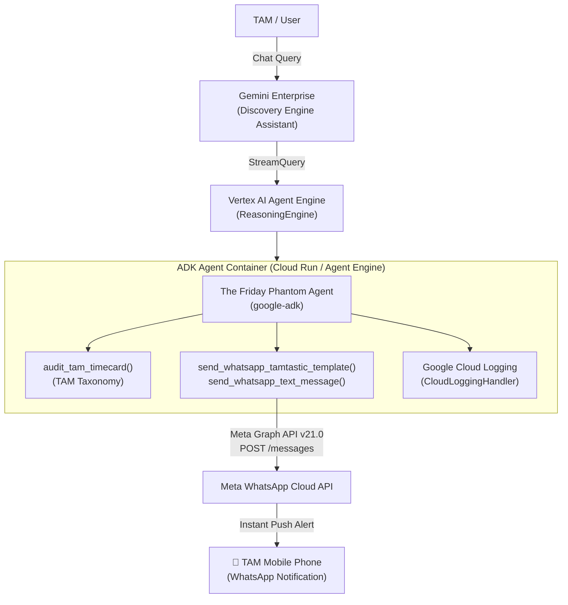

# TAMtastic GE Hackathon 2026 - Agentic AI Solutions

This repository contains the end-to-end agent implementations built for the **TAMtastic Google Enterprise (GE) Hackathon 2026**, powered by **Google ADK (Agent Development Kit)**, **Vertex AI Agent Engine**, and **Gemini Enterprise**.

---

## 🚀 Projects Overview

| Directory | Agent Name | Architecture & Highlights |
| :--- | :--- | :--- |
| [`01-basic-search-agent/`](./01-basic-search-agent) | **Basic Search Agent** | Vanilla ADK agent using `google_search` tool, deployed to Vertex AI Agent Engine and registered in Gemini Enterprise. |
| [`02-google-trends-analyst/`](./02-google-trends-analyst) | **BigQuery Trends Analyst** | BigQuery SQL expert that queries Google Trends public datasets (`international_top_terms` and `international_top_rising_terms`), enforces partition key filtering on `refresh_date`, and uses ADK's `BigQueryToolset`. |
| [`03-the-friday-phantom/`](./03-the-friday-phantom) | 👻 **The Friday Phantom** *(Creative Solution)* | **The Friday TAM Timecard Reminder Copilot**: An interactive agent in Gemini Enterprise that audits a TAM's weekly activity hours, verifies international country codes, and dispatches real-time alerts via **Meta WhatsApp Cloud API**. |

---

## 👻 Creative Solution: The Friday Phantom

### The Problem
Every Friday afternoon, Google Cloud Technical Account Managers (TAMs) face the frantic scramble to log their 40 weekly hours across complex activity categories before the 5:00 PM deadline. Unlogged hours create compliance headaches and missing customer engagement metrics.

### The Solution: "The Friday Phantom"
**The Friday Phantom** is an interactive, spectral TAM assistant living inside **Gemini Enterprise**. He hunts down TAMs across dimensions to ensure their timecards are filed before the weekend:
1. **Interactive Greeting**: Meets the TAM in Gemini Enterprise chat with playful phantom humor.
2. **Mandatory Country Code Verification**: Insists that the user provide their mobile number with an international country code (e.g., `+52`, `+1`), refusing to proceed until a valid number is supplied.
3. **WhatsApp Window Initiation**: Triggers the official `demo_tamtastic` WhatsApp template to the user's mobile phone via Meta WhatsApp Cloud API.
4. **Timecard Audit Simulation**: Inspects logged hours against the official TAM activity taxonomy (e.g., *Escalation Support P1/OMG, Cost Op Recommendations, Architecture Health Review, Technical Advisory Workshops*), detecting hourly deficits.
5. **Direct WhatsApp Alert**: Dispatches an urgent follow-up text message straight to the TAM's WhatsApp with their missing hours and categories so they cannot escape their Friday obligations!

---

## 🏗️ End-to-End Architecture



---

## 📋 Official TAM Activity Taxonomy Audited

- Technical Recommendations
- Operational Health Review
- Learning Plans
- Escalation Support P1/OMG
- Escalation Support P2-P4
- Escalation Retrospective
- Managing Billing Issues
- Capacity Planning
- Feature Request Advocacy
- Product Roadmap Advocacy
- Event Readiness & Advanced Event Readiness
- Architecture Health Review
- Cloud Security Assessment
- Cost Op Recommendations
- Technical Advisory Workshops

---

## 🛠️ Quick Start & Local Development

### Prerequisites
- Python 3.10+
- [`uv`](https://github.com/astral-sh/uv) package manager
- Authenticated `gcloud` with Application Default Credentials (`gcloud auth application-default login`)

### Running Locally
```bash
# Clone the repository
git clone https://github.com/munozhernandez-hash/ge-hackathon.git
cd ge-hackathon/03-the-friday-phantom

# Install dependencies
uv sync

# Configure environment variables
cp .env.example .env
# Edit .env with your GCP project, region, and WhatsApp credentials

# Run interactive agent CLI
uv run adk run app

# Or launch local web playground
uv run adk web . --port 8501 --reload_agents
```

### Deploying to Vertex AI Agent Engine
```bash
make backend
```

### Registering to Gemini Enterprise
```bash
make register-gemini-enterprise
```

---

## 🏆 Scoring Pillars Alignment

- **Production-Ready Solution**: Robust phone normalization (handling Mexican 10/12/13-digit formatting and 52 vs 521 sandbox fallbacks), comprehensive error handling, and structured Cloud Logging.
- **Most Impactful**: Solves a real internal operational pain point for hundreds of TAMs worldwide, driving timecard compliance and saving administrative overhead.
- **Most Loved**: Delivers a memorable, witty persona and a delightful live mobile push notification on camera during the live demo.
